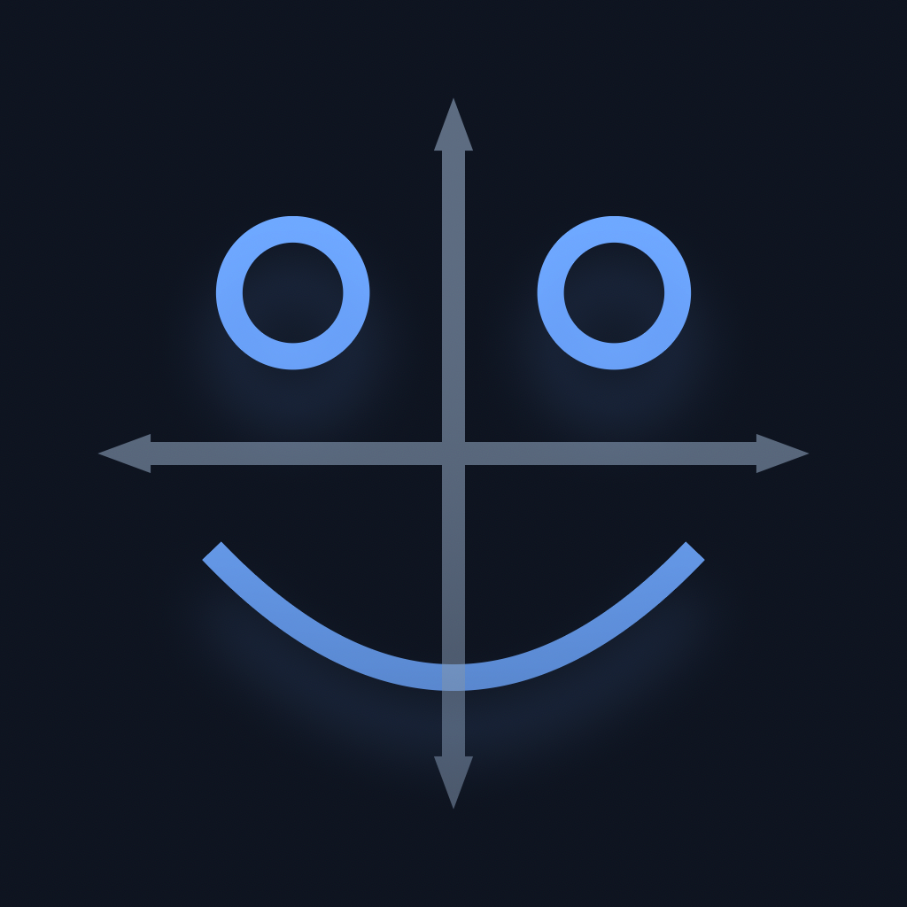
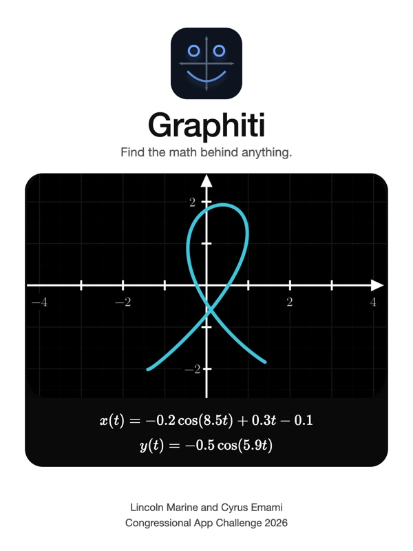

<h1 align="center">Graphiti</h1>

Congressional App Challenge 2026 Lincoln Marine and Cyrus Emami

Demo video: (link coming)

---

Graphiti is an iPhone app that works like a graphing calculator in reverse: instead of typing an equation and seeing the shape, you draw the shape with your finger and the app finds an equation that produces it. The formal name for this problem is symbolic regression, which just means searching over possible formulas rather than fitting the numbers inside one fixed formula, and we think it matters because most of the shapes people actually draw or see dont come with an equation attached, so there was no good way to go from a picture back to the math.

The pipeline works in a few stages, and we explain each one because the order is important. First, the stroke is resampled and normalized, meaning the points are spaced out evenly along the curve and scaled into a standard box, so that a fast scribble and a slow careful line are treated the same. Next, a small temporal convolutional network (a neural net that reads the stroke as a sequence, trained in PyTorch and run on the phone through Core ML) looks at the geometry of the stroke and estimates how noisy each part of it is. This matters because human drawing noise is not random static, it is correlated, your hand wobbles in a consistent direction for a stretch and then corrects, and therefore the search needs to know where it should be strict and where it should be forgiving. The network produces a continuous noise field that is used for exactly this.

The search itself is genetic programming written in C++. Simple strokes that can be written as y as a function of x are searched with one expression tree. More complex shapes, like loops or spirals, are searched parametrically with two trees, one for x(t) and one for y(t), where t runs from 0 to 1 and is treated as a free parameter that gets optimized together with the equations. Importantly, the drawn order of the points is always kept, and a continuous spline is used to warp t onto the shape, so the search is never allowed to cheat by reordering the drawing. The building blocks available to the search are constants, addition, subtraction, multiplication, division, sine, cosine, exponential, log and square root, and candidate formulas built from these mutate and recombine over many generations.

Notably, evaluating all of those candidates is where almost all of the time goes, so we wrote custom Apple Metal GPU kernels that score thousands of candidate equations at the same time on the phones graphics processor. Each candidate is scored with a noise weighted minimum description length score, which balances how well the formula matches the stroke (weighted by the noise field, so wobbly regions count less) against how complicated the formula is. The winner is then the simplest formula that lands inside a statistical likelihood band, meaning any formula in that band explains the stroke about as well as the noise allows, and so we pick the shortest one rather than the one that happens to fit the noise best. All of this runs on the phone and nothing is sent to a server.

Also, it took a lot of iteration to get here. We started with PySR, an existing symbolic regression library, which took about five minutes per search, and we are now down to seconds; many of the approaches we tried along the way did not work and were thrown out. The training data for the noise network came from Google's QuickDraw dataset, and labeling it turned out to be one of the harder parts of the project.

The app is written in SwiftUI with KaTeX for rendering the equations. The design took cues from Liquid Glass and from 3Blue1Brown's Manim, and the solve animations are all done in code. Results come out as math cards you can share, and there is also a Discover tab for browsing shapes.

## What's in here

| folder | contents |
|---|---|
| `app/` | The iPhone app. `GraphitiKit/` is the SwiftUI interface: canvas, solve screen, equation cards, gallery and sharing. `GraphArt/Engine/` is the version of the search engine that ships in the app, compiled straight into the Xcode project. The GPU kernels are produced by the Python scripts in `kernels/` (we generate the Metal source because there are hundreds of kernel variants), and the compiled kernel libraries and noise model the app loads are under `resources/`. |
| `engine/` | The desktop version of the search engine we developed against. `include/sketch/` holds the genetic programming search, the scoring and the selection logic. `src/` has the C bridge and a Python binding we used for experiments. `shaders/` is the Metal scoring kernel. |
| `noise-model/` | The temporal convolutional network that estimates stroke noise, in PyTorch, and the script that converts it to Core ML. |
| `samples/` | Some test strokes, both clean primitives and real hand-drawn ones. |
| `assets/` | Logo and cover art. |
